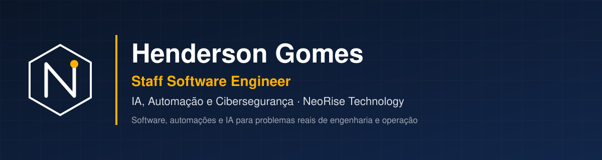

  

  
  
  

Desenvolvo software, automações e soluções com inteligência artificial para problemas de engenharia e operação, com atenção a segurança desde o início.

---

## 🚀 Produtos

### ChatME
Assistente com IA para conferência de orçamentos de obra: aponta divergências verificáveis, mostra fontes e investiga serviços relacionados que podem não estar contemplados, para revisão do responsável técnico. Em desenvolvimento ativo. · [chatme.ia.br](https://chatme.ia.br)

### oculto-scan
Scanner de vazamento de dados em planilhas Excel antes de publicar propostas, medições e orçamentos. Identifica dados sensíveis sem executar macros. · [repositório](https://github.com/HendersonGomes/oculto-scan)

**Também construindo:** Condomínio Fácil · ERP Suínos · Certidões Licitação · Site NeoRise

---

## 🛠️ Ferramentas

- **Desenvolvimento:** TypeScript · React · Python
- **IA e desenvolvimento assistido:** Cursor · Claude Code · Claude · Grok
- **Dados e infraestrutura:** Supabase · PostgreSQL · Vercel · Cloudflare

  
  
  
  
  
  
  
  

---

## 🧭 Trajetória

- **NeoRise Technology** · software sob medida, automações e produtos próprios com IA.
- **Brasil360** · colunista de Engenharia e Tecnologia.

<b>Diferencial de domínio: engenharia civil</b>

Engenheiro civil com MBA em Perícia, Avaliações e Auditoria de Engenharia e pós-graduação em Engenharia de Custos, com centenas de obras executadas. Esse conhecimento de campo orienta os produtos que construo para orçamento, medição e licitações.

---

 

